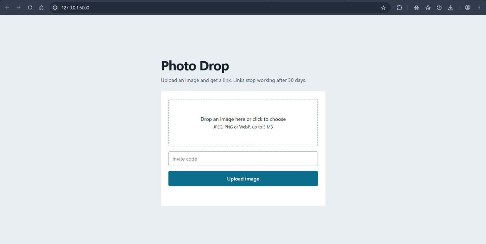
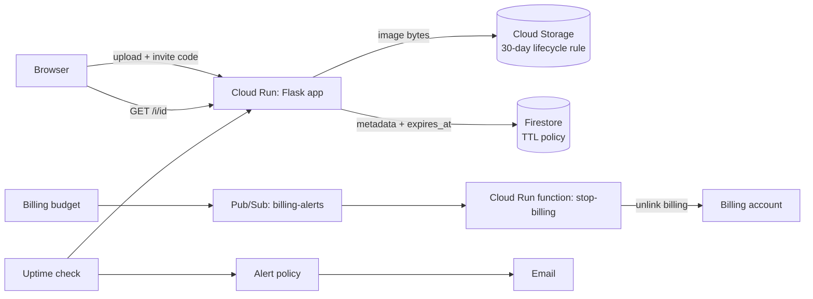

# Photo Drop

An invite-only image hosting service designed for Google Cloud. Upload a JPEG, PNG or WebP (up to 5 MB) and get a shareable link that expires after 30 days.

I built this after finishing the **Google Cloud Fundamentals: Core Infrastructure** course, to practice its main ideas (IAM, storage, serverless, databases, monitoring, billing controls and infrastructure as code) in one small, realistic design.

> **Status:** designed, built and tested locally. **Not deployed to Google Cloud.**
> The Python code has 15 passing automated tests, and the Terraform configuration passes `terraform validate`, but it has not been applied to a real project. The Google Cloud storage code (`GcpBackend`) has not been run against real Google Cloud either.

## Demo



A short screen recording is in `docs/demo.mp4` (upload, open the link, error handling, and the test run).

<!-- Replace the file names above with your own screenshot and video names in the docs folder. -->

## Architecture



## How it works

1. A user opens the page, picks an image and enters the invite code.
2. The app checks the code, then opens the file to confirm it is really a JPEG, PNG or WebP (the file extension is not trusted), enforces the 5 MB limit, and re-encodes the image, which removes EXIF data such as camera details and GPS location.
3. The image gets a random 8-character ID and is stored. The user receives a link like `/i/x7Kp2aBc`.
4. Anyone with the link can view the image until it expires 30 days later.

## Course concepts and where they appear

| Course topic | In this project |
|---|---|
| Projects, IAM, service accounts | Separate least-privilege service accounts for the app and the kill switch (`terraform/main.tf`, `terraform/cost_guard.tf`) |
| Cloud Storage | Private bucket, public access prevention, 30-day lifecycle delete rule |
| Cloud Run (serverless containers) | Flask app in a container, scale to zero, maximum 2 instances |
| Firestore | Image metadata with a TTL policy on `expires_at` |
| Event-driven functions and Pub/Sub | A budget alert triggers the `stop-billing` function |
| Monitoring and alerting | Uptime check on `/healthz` and an email alert policy (`terraform/monitoring.tf`) |
| Billing controls | $1 budget alert and an automatic billing unlink (ships in dry-run mode) |
| Infrastructure as code | Every resource is defined in `terraform/` |

## Design decisions

- **Cloud Run instead of Compute Engine:** the app is stateless and low traffic, so scale to zero means no idle cost and no servers to patch.
- **Private bucket:** images are served through the app, so access rules and expiry are enforced in one place.
- **Expiry enforced three ways:** an app check, the bucket lifecycle rule, and the Firestore TTL policy.
- **Uploads are verified, not trusted:** content check, three allowed formats, size limit, decompression-bomb limit, and re-encoding.
- **Fail closed:** if no invite code is configured, uploads are disabled.
- **Two storage backends:** `BACKEND=local` keeps files on disk so the app runs and tests without a cloud account, and `BACKEND=gcp` uses Cloud Storage and Firestore.
- **Kill switch starts in dry-run mode:** it logs what it would do until you set `DRY_RUN` to `"false"`, so it cannot unlink billing by accident.

## Project structure

```
photo-drop/
  app/            Flask app (main.py), storage backends (storage.py), upload page (static/index.html)
  killswitch/     Cloud Run function that unlinks billing when spend passes the budget
  terraform/      Infrastructure definition (app, storage, database, IAM, monitoring, cost guard)
  tests/          Automated tests for the app and the kill switch
  Dockerfile      Container image for Cloud Run
```

## Run it locally

Requires Python 3.12 (newer versions may not have prebuilt packages for Pillow yet).

**Windows (PowerShell)**

```powershell
py -3.12 -m venv .venv
.venv\Scripts\Activate.ps1
python -m pip install -r requirements-dev.txt
python -m pytest                       # expect: 15 passed

cd app
$env:INVITE_CODE="choose-a-code"
flask --app "main:create_app" run
```

**macOS / Linux**

```bash
python3.12 -m venv .venv
source .venv/bin/activate
python -m pip install -r requirements-dev.txt
python -m pytest                       # expect: 15 passed

cd app
INVITE_CODE=choose-a-code flask --app "main:create_app" run
```

Then open http://127.0.0.1:5000.

**With Docker**

```bash
docker build -t photo-drop .
docker run -p 8080:8080 -e INVITE_CODE=choose-a-code photo-drop
```

## Check the Terraform

This needs no Google Cloud account and costs nothing:

```bash
cd terraform
terraform init
terraform validate
```

## Deploying later (untested)

1. Create a Google Cloud project and billing account, then copy the values in `terraform/terraform.tfvars.example` into a new `terraform/terraform.tfvars` (this file is git-ignored, so your invite code stays private).
2. Create the registry first: `terraform apply -target=google_project_service.apis -target=google_artifact_registry_repository.repo`
3. Build and push the image: `gcloud builds submit --tag REGION-docker.pkg.dev/PROJECT/photo-drop/app:latest .`
4. `terraform apply`
5. Test the kill switch in dry-run mode, then set `DRY_RUN` to `"false"` to arm it.

## Cost controls

The design is meant to stay within Google Cloud's Free Tier: a US Free Tier region (us-central1), scale to zero, a cap of 2 Cloud Run instances, 5 MB uploads, 30-day expiry, and a billing kill switch. Budget alerts can lag by hours, so these controls reduce the risk of charges but cannot guarantee zero. Check Google's current Free Tier limits before deploying.

## Known limitations

- The invite code is one shared secret passed as an environment variable. Secret Manager would be a better home for it.
- There is no per-IP rate limiting on the upload endpoint.
- Viewing images counts as outbound data, which has a small free allowance.
- The Terraform configuration validates but has not been applied, and `GcpBackend` has not been run against real Google Cloud.

## What I would add next

- Moderation and a report-and-remove flow, which public uploads would need.
- Secret Manager for the invite code.
- Rate limiting.
- A CI pipeline that runs the tests and `terraform validate` on every push.